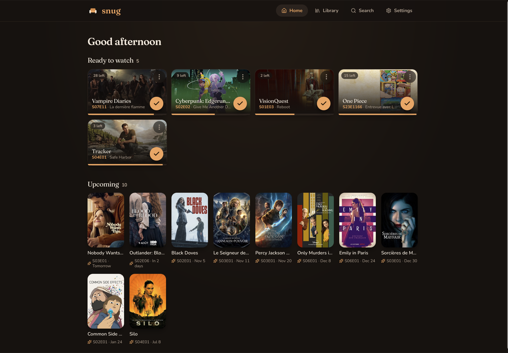
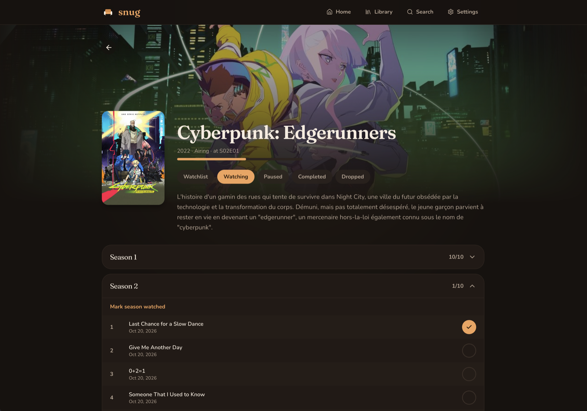
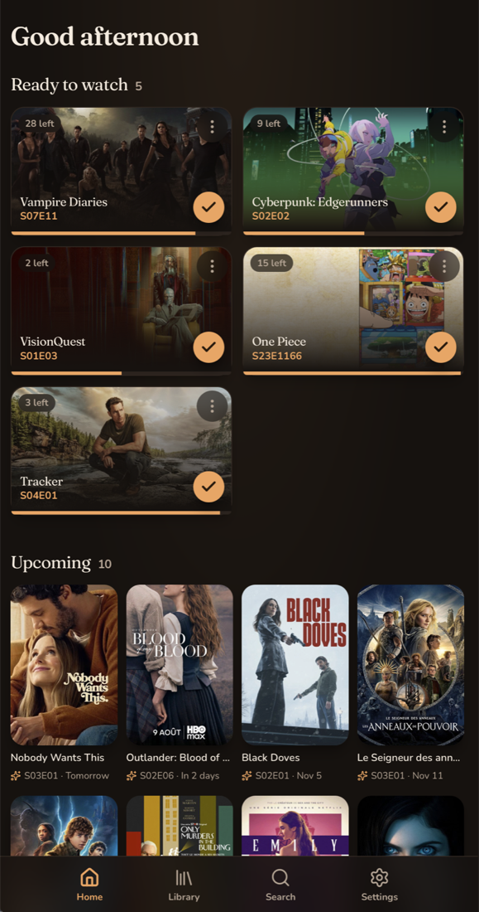

<div align="center">


# Snug

**A cozy, self-hosted tracker for the TV series you're watching.**
Where you are (S02E05), what's next, what airs soon. One tap to mark an episode watched.

[](https://github.com/mathieuletyrant/snug/pkgs/container/snug)




</div>

## ✨ Features

**Track**

- 🛋️ **Home**: *Ready to watch* and *Upcoming*, one tap ✓ for the next episode (with undo)
- 🆕 **New mode**: freshly aired episodes first
- 📺 **Statuses**: Watchlist, Watching, Saving up (wait for a full season or N episodes), Paused, Completed, Dropped
- 📊 **Progress** per season, time left to watch
- ⭐ **Ratings** out of 10, per series and per season
- 🙈 **Spoiler shield**: unwatched episode titles hidden until tapped

**Connect**

- 🪼 **Jellyfin**: watched episodes tracked automatically, webhook history
- 🔔 **Push notifications**: new episode out, episode watched in Jellyfin (iPhone: Home Screen app over HTTPS)
- 📣 **ntfy**: the admin's notifications on ntfy topics, next to the *arr stack's
- 🤖 **AI assistant** (MCP): Claude manages your library, imports your TV Time / Trakt history
- 📡 **Sonarr**: your Watchlist as a Custom List, so it gets downloaded
- 🎬 **Spotarr**: a series from a shared reel lands on your Watchlist
- 📅 **Calendar**: iCal feed of upcoming episodes
- 📥 **Import & export**: CSV ([template](apps/web/public/snug-import-template.csv)) or JSON export in, the same CSV out

**App**

- 🌍 English or French, TMDB data in your language
- 📱 PWA: installable, offline, mobile-first
- 🔐 Accounts: the first one is admin, sign-up closed after
- ⚡ Bun + SQLite, home in ~20 ms for 190 series

<table>
  <tr>
    <td width="68%"></td>
    <td width="32%"></td>
  </tr>
</table>

## 🚀 Run it

```sh
docker run -d --name snug -p 3000:3000 -v ./data:/data \
  -e SNUG_ORIGINS=http://localhost:3000 \
  ghcr.io/mathieuletyrant/snug:latest
```

Open http://localhost:3000, create the admin account, paste a [TMDB key](https://www.themoviedb.org/settings/api) (v3 API key or v4 read access token) and pick a language.

| Env | Default | |
|---|---|---|
| `SNUG_ORIGINS` | – | Comma-separated URLs you open Snug with (LAN name, IP, Tailscale…) |
| `DATA_DIR` | `/data` | SQLite database, image cache, generated auth secret |
| `BETTER_AUTH_SECRET` | generated in `DATA_DIR/secret` | |
| `LOG_LEVEL` | `info` | `debug` adds every request, ignored Jellyfin calls and TMDB calls; `warn` keeps only problems |
| `LOG_FORMAT` | readable lines | `json` for one pino JSON object per line |
| `PORT` | `3000` | |
| `TZ` | `UTC` | Time zone deciding which day it is: when an Episode counts as out, when new-Episode notifications go (from 4 pm). E.g. `Europe/Paris` |
| `SNUG_PUSH_CONTACT` | first `https://` origin | Contact sent to push services (`https://…` or `mailto:…`) |

The image is multi-arch (amd64 / arm64), tagged `latest`, `x.y` and `x.y.z`.

To back up the whole instance, copy `DATA_DIR` while Snug is stopped. Each user can also download their own series as CSV from Settings → Import & export.

## 🪼 Jellyfin

1. Install the **Webhook** plugin (Dashboard → Plugins → Catalog) and restart Jellyfin.
2. Add a **Generic Destination** with your webhook URL from Snug → Settings → Integrations → Jellyfin.
3. Tick **Playback Stop** and **User Data Saved**, select your user, tick **Send All Properties**.

> [!TIP]
> The URL must be reachable **from Jellyfin's container**: use Snug's LAN address or `host.docker.internal`, not `localhost`.

## 📣 ntfy

The admin sets it once for the instance in Settings → Integrations → ntfy: server URL (empty for ntfy.sh), an optional access token, topics and tags, like Sonarr's ntfy connection. **Send a test** checks the form before saving.

The admin's notifications then also go to those topics; the other users keep Web Push. A tap opens the series in Snug, at the first `https://` origin of `SNUG_ORIGINS` (or the first one).

> [!TIP]
> With ntfy in the same Docker network, use its container name, e.g. `http://ntfy:80`.

## 🛠️ Develop

```sh
bun install
bun run dev          # API on :3000, web on http://localhost:5173 (shares ./data with Docker)
bun test
bun run typecheck
docker compose up --build   # production build locally on :3000
```

After a schema change: `cd apps/server && bun run db:generate` (migrations run at startup).

```
apps/server      Bun · Hono · Drizzle (SQLite) · better-auth
  src/modules/<module>/{domain,application,infrastructure,http}
    catalog      Series & Episodes from TMDB (cached, refreshed daily)
    tracking     TrackedSeries aggregate: Status, Watches, Progress
    identity     accounts, sessions, preferences, webhook tokens
    mcp          AI assistant (MCP server): tools and prompts over the other modules
    jellyfin     webhook → Watches, history
    feeds        read-only lists for other apps (Sonarr, iCal calendar)
    notifications  Web Push to the User's devices, ntfy for the admin
    import       CSV / JSON export ⇄ TrackedSeries
    watchlist    add to the Watchlist from other apps (Spotarr)
apps/web         React 19 · Vite · Tailwind 4 · Radix UI · TanStack Query, PWA
  src/pages        one file per screen (settings/: one per tab), made of components
  src/components   ui/ building blocks (Button, Chips, Card, Poster…), series/ series pieces,
                   layout, sheets, forms
  src/lib          pure helpers (formatting, episode rules), tested
packages/shared  API contract types
```

### 📦 Releases

Fully automatic, driven by [Conventional Commits](https://www.conventionalcommits.org) (`feat:` → minor, `fix:` → patch):

1. Every push to `main` opens or updates a **release PR** with the next version and the CHANGELOG.
2. Merging it creates the tag and GitHub release, then builds and publishes the Docker image.

📖 Vocabulary: [GLOSSARY.md](GLOSSARY.md) · 🧭 Decisions: [docs/adr](docs/adr)
